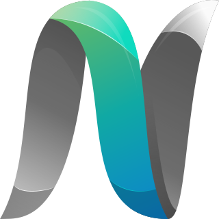

<p align="center">
  
</p>

<h1 align="center">@nubisco/docs-sdk</h1>

<p align="center">The Nubisco documentation design as one package: VitePress, the theme, the plugins and a config helper. A product supplies its content and a small config.</p>

<p align="center">
  <a href="https://www.npmjs.com/package/@nubisco/docs-sdk"></a>
  <a href="LICENSE"></a>
</p>

## What it gives you

- **The design.** Neutral layer colours, a page header that is an inset card and closes
  into a bar as you scroll, tabs that are pages, a left navigation with a filter, and
  "On this page" on the right. Light, dark and auto.
- **VitePress, bundled.** Your project depends on this package, not on VitePress. One
  version of VitePress across every site.
- **The plugins.** Tabs, mermaid diagrams and grouped code icons, already wired.
- **A config helper.** `defineNubiscoDocs` sets everything the design fixes. You state
  your name, address, repository, navigation and footer.
- **A CLI.** `nubisco-docs dev | build | preview`.

## Install

```sh
pnpm add -D @nubisco/docs-sdk @nubisco/ui vue
```

`@nubisco/ui` and `vue` are peer dependencies: the theme is built from the library's
components and tokens, and there must be one copy of each.

## Use

```ts
// docs/.vitepress/config.ts
import { defineNubiscoDocs } from '@nubisco/docs-sdk'

export default defineNubiscoDocs({
  title: 'Acta',
  description: 'What Acta is, in one sentence.',
  base: '/acta/',
  hostname: 'https://docs.nubisco.io/acta/',
  repo: 'nubisco/acta',
  nav: [
    { text: 'Users', link: '/users/' },
    { text: 'Developers', link: '/developers/' },
  ],
  sidebar: {
    '/users/': [
      { text: 'Start', items: [{ text: 'Welcome', link: '/users/' }] },
    ],
  },
  footer: {
    copyright: 'Copyright © 2026 <a href="https://nubisco.io">Nubisco</a>',
  },
})
```

```ts
// docs/.vitepress/theme/index.ts
import theme from '@nubisco/docs-sdk/theme'
export default theme
```

```json
{
  "scripts": {
    "docs:dev": "nubisco-docs dev",
    "docs:build": "nubisco-docs build"
  }
}
```

Pages opt in with `layout: nubisco` in frontmatter. The fields the layout reads are
`title`, `intro` (one paragraph of inline Markdown), `status` (`stable`, `beta`, `labs`...),
`source` (a path in the repository, for the source link) and, for a page with facets,
`pageTabs` plus `tab`.

The `fixture/` folder is a complete small site that uses the package exactly as above. It is
built in CI on every change.

## Contributing

See [CONTRIBUTING.md](CONTRIBUTING.md). Contributions are made under the
[Contributor License Agreement](docs/CLA-INDIVIDUAL.md). Security reports: see
[SECURITY.md](SECURITY.md).

## Acknowledgements

The layout draws inspiration from [IBM Carbon Design System](https://carbondesignsystem.com)
documentation structure. Carbon is the work of IBM and its contributors, licensed under Apache 2.0.
The tabs and mermaid plugins are adapted from `vitepress-plugin-tabs` and
`vitepress-plugin-mermaid`, both MIT. See [THIRD_PARTY_NOTICES.md](THIRD_PARTY_NOTICES.md).

---

## License

[MIT](LICENSE)
